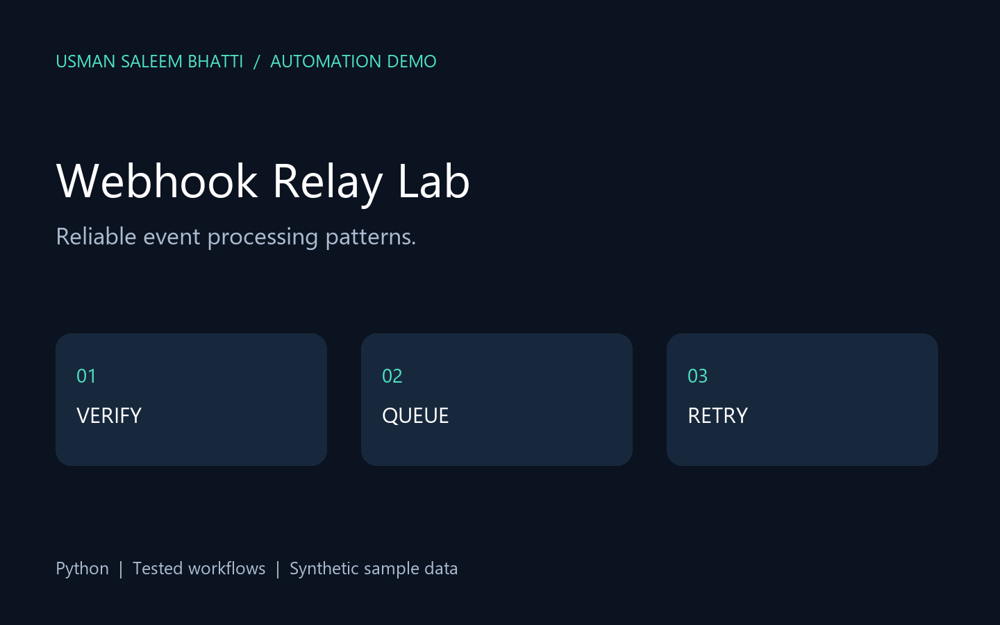

# Webhook Relay Lab

Signed event processing with a durable queue, bounded retries and dead-letter handling.



## Workflow

`HMAC validation → timestamp check → durable queue → retry policy → delivered/dead letter`

## Features

HMAC verification, replay-window checking, event-ID deduplication, SQLite persistence, exponential backoff, synthetic failure simulation.

## Quick start

Python 3.11 or newer. No third-party dependencies.

```sh
python app.py --demo --output runs
python -m unittest discover -v
```

Open `runs/report.html` in a browser. `runs/result.json` contains structured output. Demo reruns reuse their local ledger where applicable; use a fresh output folder to repeat the first-run scenario.

## What is tested

The unit tests cover the business rules, malformed inputs and important failure paths. The generated `demo-report.html` is a checked-in sample report for quick inspection. Runtime output and databases are ignored by Git.

## CI

`.github/workflows/tests.yml` runs the tests and the demo on every push and once a day, and uploads the HTML report as an artifact.

## Scope and limitations

A single-worker integration core, not a production HTTP service. Delivery is simulated. Real adapters must forward idempotency keys; delivery is at-least-once across crashes. Concurrency, TLS, rate limits and deployment monitoring are future work.

---

Built by [Usman Saleem Bhatti](https://www.upwork.com/freelancers/~017ac7683856df4451). Events in the demo are synthetic.
